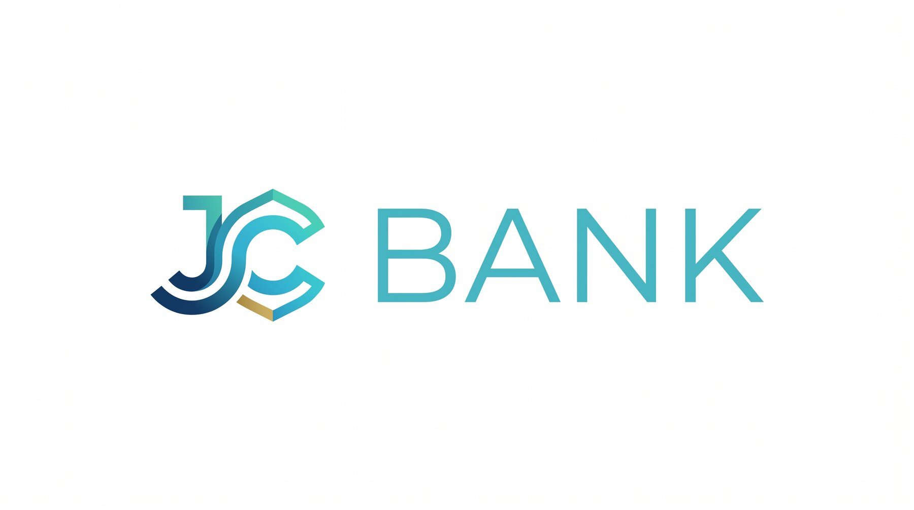

<p align="center">
  <picture>
    <source media="(prefers-color-scheme: dark)" srcset="assets/logo-dark.jpeg">
    <source media="(prefers-color-scheme: light)" srcset="assets/logo-light.jpeg">
    
  </picture>
</p>

# JC Bank

API de banco digital criada para fins de estudo com **Kotlin** e **Spring Boot**.

## Sobre o projeto

O JC Bank é uma API REST que vai permitir cadastrar clientes, abrir contas e realizar operações bancárias, como depósito, saque e transferência.

Nesta fase inicial, o projeto apenas sobe o servidor — as funcionalidades serão adicionadas aos poucos, junto com o aprendizado.

> Projeto de estudo. Não deve ser usado em produção.

## Material das aulas

Os conteúdos e as práticas de cada aula ficam em [`aulas/`](aulas/README.md).

## Tecnologias

- Kotlin
- Spring Boot 4
- Java 21
- Gradle (Kotlin DSL)

## Como rodar

Pré-requisito: **JDK 21**.

```bash
./gradlew bootRun
```

A aplicação sobe em `http://localhost:8080`. Por enquanto não há endpoints, então acessar essa URL retorna `404` — isso é esperado.
